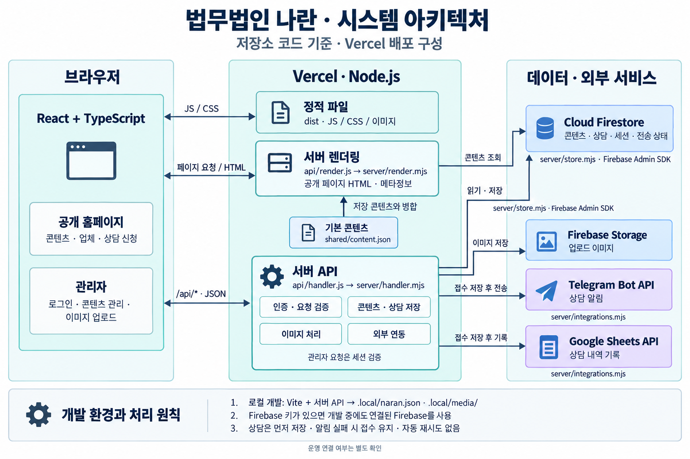

# 개발자 인수인계

작성일: 2026-10-07 · 코드 확인 기준: `main` / `79a4d71`

법무법인 나란의 공개 홈페이지, 상담 접수, 비밀번호 기반 관리자 시스템입니다. 다음 개발자가 개발을 재개할 때 필요한 구조와 주의사항을 정리했습니다. 실제 운영 주소·계정 소유자·배포 상태는 아래 전달표를 채워 확정하세요.

## 1. 먼저 읽을 문서

| 문서 | 용도 |
| --- | --- |
| [README.md](./README.md) | 프로젝트 개요와 빠른 실행 |
| [HANDOVER.md](./HANDOVER.md) | 코드 구조, 변경 시 주의사항, 남은 일과 전달 항목 |
| [OPERATIONS.md](./OPERATIONS.md) | 환경변수, 외부 서비스 연결, 비밀번호, 배포·운영 절차 |
| [ADMIN_FEATURE_PARITY.md](./ADMIN_FEATURE_PARITY.md) | 참고 사이트와의 기능 대조, 관리자 화면 범위 |

운영 절차를 변경하면 `OPERATIONS.md`를 수정하고, 담당자·진행 상태·남은 작업이 바뀌면 이 문서를 갱신합니다.

## 2. 새 개발 환경에서 시작하기

Node.js **24 이상**, npm을 사용합니다. React 19, TypeScript, Vite 기반이며 서버는 Node.js의 `.mjs` 모듈로 구현되어 있습니다. 의존성 버전은 [package.json](./package.json)과 `package-lock.json`을 기준으로 합니다.

```powershell
npm ci
```

환경변수가 없는 새 작업 사본에서는 다음 명령으로 예시 파일을 복사할 수 있습니다. 기존 파일은 덮어쓰지 않습니다.

```powershell
if (-not (Test-Path -LiteralPath .env.local)) {
  Copy-Item -LiteralPath .env.example -Destination .env.local
}
```

`.env.local`의 `SITE_URL`을 `http://127.0.0.1:5173`으로 수정하세요. 예시의 `https://your-domain.com`을 그대로 두면 로그인·저장 요청이 출처 검증에서 거절됩니다.

외부 연동 없이 시작하려면 `.env`, `.env.local` 및 셸 환경에 실제 Firebase·Telegram·Google Sheets 자격 증명이 설정되어 있지 않은지 확인합니다. **개발 모드라도 Firebase 키가 있으면 연결된 실제 DB를 사용합니다.** 연동 개발에는 별도 테스트 프로젝트를 사용하세요.

```powershell
npm run dev
```

- 공개 화면: `http://127.0.0.1:5173/`
- 관리자: `http://127.0.0.1:5173/admin`
- 새 로컬 환경에서 `ADMIN_PASSWORD_HASH`가 비어 있으면 관리자 첫 접속 시 비밀번호를 설정합니다.
- Firebase 미설정 개발 환경의 데이터는 `.local/naran.json`, 업로드 이미지는 `.local/media/`에 저장됩니다. Git에는 포함되지 않습니다.
- `npm start`와 `npm run preview`는 빌드 결과를 제공하는 운영 모드입니다. 개발용 로컬 저장을 사용하지 않으므로 관리자·접수 기능까지 확인하려면 운영에 필요한 Firebase·비밀번호 설정이 필요합니다. 일반 개발은 `npm run dev`로 시작하세요.

## 3. 시스템 아키텍처



공개 화면과 관리자는 같은 React 앱을 사용합니다. 공개 페이지의 초기 HTML은 서버에서 생성하며, 콘텐츠 조회·상담 접수·관리자 작업은 `/api/*`로 처리합니다. Firestore 접근과 외부 연동 자격 증명은 서버에서만 사용합니다. 업로드 이미지는 서버가 발급한 Firebase Storage 다운로드 URL로 브라우저에 표시합니다.

그림은 저장소의 Vercel 배포 구성을 나타냅니다. 로컬 개발에서는 Vite가 서버 API를 연결하고, Firebase가 설정되지 않은 경우에만 `.local/` 저장소를 사용합니다. 상담은 저장을 마친 뒤 Telegram·Sheets로 전송하며, 전송 결과도 저장합니다. 실제 운영 연결 상태는 별도 확인이 필요합니다.

[이미지 원본](./docs/images/naran-system-architecture.png) · [이미지 생성 프롬프트](./docs/images/naran-system-architecture.prompt.txt)

## 4. 기능별 코드 위치

| 수정할 내용 | 먼저 볼 파일 |
| --- | --- |
| 브라우저 라우팅·콘텐츠 로딩 | [src/App.tsx](./src/App.tsx), [src/lib/api.ts](./src/lib/api.ts) |
| 홈·공통 레이아웃 | [src/pages/Home.tsx](./src/pages/Home.tsx), [src/components/Layout.tsx](./src/components/Layout.tsx), [src/styles.css](./src/styles.css) |
| 소개·업무 분야·사례·가이드 등 공개 화면 | [src/pages/PublicPages.tsx](./src/pages/PublicPages.tsx) |
| 업체 상세·광고 랜딩 | [src/pages/Companies.tsx](./src/pages/Companies.tsx), [src/pages/Landing.tsx](./src/pages/Landing.tsx) |
| 상담 입력·유입 정보 | [src/pages/Consultation.tsx](./src/pages/Consultation.tsx), [src/lib/attribution.ts](./src/lib/attribution.ts) |
| 관리자 로그인·메뉴 | [src/pages/Admin.tsx](./src/pages/Admin.tsx) |
| 롤링 사례·업체·파워링크 관리 | [src/pages/AdminReference.tsx](./src/pages/AdminReference.tsx) |
| 콘텐츠·사이트 설정 관리 | [src/pages/ContentManager.tsx](./src/pages/ContentManager.tsx), [src/pages/AdminSettings.tsx](./src/pages/AdminSettings.tsx) |
| 업체 본문 편집기(네이버 블로그 방식)·표시 | [src/components/CompanyDocumentEditor.tsx](./src/components/CompanyDocumentEditor.tsx), [src/components/editor/](./src/components/editor/), [src/components/CompanyDocument.tsx](./src/components/CompanyDocument.tsx), [shared/company-document.mjs](./shared/company-document.mjs) |
| API 분기·상담 저장·관리자 처리 | [server/handler.mjs](./server/handler.mjs) |
| 인증·세션·요청 출처 검증 | [server/auth.mjs](./server/auth.mjs) |
| Firestore·로컬 저장·기본 콘텐츠 병합 | [server/store.mjs](./server/store.mjs), [shared/content.json](./shared/content.json) |
| 업체·파워링크 처리·이미지 업로드 | [server/reference.mjs](./server/reference.mjs), [server/media.mjs](./server/media.mjs) |
| Telegram·Google Sheets 전송 | [server/integrations.mjs](./server/integrations.mjs) |
| 서버 렌더링·메타정보·사이트맵 | [server/render.mjs](./server/render.mjs), [src/entry-server.tsx](./src/entry-server.tsx) |
| Vercel 진입점·경로 연결·번들 설정 | [api/handler.js](./api/handler.js), [api/render.js](./api/render.js), [vercel.json](./vercel.json), [vite.config.ts](./vite.config.ts) |

개발 중에는 Vite가 `/api` 요청을 서버 핸들러로 연결합니다. Vercel에서는 `api/` 진입점이 같은 서버 모듈을 사용하며, 공개 페이지의 초기 HTML은 React 서버 렌더링으로 생성합니다. `dist`만 정적 호스팅에 올리면 관리자·상담 기능이 동작하지 않습니다.

## 5. 변경 전에 알아둘 동작

- **기본 콘텐츠와 저장 콘텐츠:** `shared/content.json`에 관리자 저장값을 병합하며 같은 ID는 저장값이 우선합니다. 기본 파일만 바꿔도 운영 화면에 반영되지 않을 수 있습니다. `scripts/seed-content.mjs`는 이 JSON을 다시 쓰는 스크립트이며, 최초 실행에 필요한 DB 이관 명령이 아닙니다.
- **관리자 범위:** 현재 메뉴는 홈 롤링 사례·사기업체·파워링크·콘텐츠·사이트 설정입니다. 상담 관리·외부 연동 재시도·활동 기록 화면은 없습니다. 관련 서버 API가 남아 있어도 화면이 제공되는 것은 아닙니다.
- **업체 노출:** `검색차단`은 내부 목록·검색에서만 숨깁니다. 직접 주소와 외부 검색 색인은 유지됩니다. `전화연결`은 내부 목록에서 숨기고 상세 주소에 전화 안내를 표시합니다.
- **광고 URL:** `POWERLINK_URL_SECRET`을 바꾸면 기존 URL을 해석할 수 없습니다. 관리 목록에서 링크를 삭제해도 이미 배포한 URL은 계속 유효합니다. 키·경로 접두사 변경은 기존 광고 주소의 영향을 확인한 뒤 진행하세요.
- **상담 저장과 알림:** 접수를 먼저 저장하고 Telegram·Sheets 전송 결과를 각각 기록합니다. 전송 실패가 접수 실패를 뜻하지 않습니다. 자동 재시도 스케줄러는 없으며, 인증된 `POST /api/admin/consultations/:id/retry`로 재시도합니다. Telegram은 타임아웃 전에 도착했을 수 있어 수신 내역 확인이 필요합니다.
- **관리자 인증:** 개인 계정 없이 공유 비밀번호를 사용하며 세션은 8시간입니다. 비밀번호 교체 시 기존 세션은 무효화됩니다. 운영 비밀번호 설정은 `npm run admin:password`와 서버의 `ADMIN_PASSWORD_HASH` 등록 절차를 따릅니다.
- **서버 전용 환경변수:** `.env.example`의 자격 증명에 `VITE_` 접두사를 붙이지 않습니다. 운영 `SITE_URL`은 실제 접속 origin과 맞춰야 하며, 운영 인증에는 HTTPS가 필요합니다.
- **업체 상세 본문 형식:** 편집기(TipTap)는 `{ version: 2, html }`로 저장합니다. 상세페이지·미리보기는 `shared/company-document.mjs`의 `sanitizeContent`로 정제한 HTML만 표시하므로, 편집기에 새 서식이나 노드를 추가하면 이 허용 목록과 `src/components/company-document.css`도 함께 맞춰야 합니다. 이전 블록 편집기의 `{ version: 1, blocks }` 본문은 읽을 때 `documentHtml`로 HTML 변환하며, 편집기에서 다시 저장하면 version 2가 됩니다. 본문 사진은 저장 시점에 업로드하고, 본문에서 빠진 업로드 사진은 저장 후 정리합니다.
- **개발 데이터 이관:** `.local/` 데이터는 Firebase로 자동 이관되지 않습니다. 필요한 콘텐츠와 이미지를 선별해 별도 이관 계획을 세워야 합니다.

### 최근 Vercel 호환성 수정

`37d2d12`와 `79a4d71`에서 서버 함수의 HTML 처리 라이브러리 로딩과 SSR 의존성 누락 문제를 다뤘습니다. 현재 `vite.config.ts`의 `ssr.noExternal: true`는 SSR 의존성을 번들에 포함합니다.

`npm run build` 마지막 단계인 [scripts/check-server-runtime.mjs](./scripts/check-server-runtime.mjs)는 ESM 직접 로딩이 제한된 조건에서 API·SSR 진입점을 검사하고, 프로젝트의 `node_modules` 없이도 SSR 번들이 동작하는지 확인합니다. 의존성·SSR·배포 설정을 바꿀 때 이 검사를 유지하고 실제 배포에서도 상세페이지를 확인하세요.

## 6. 현재 상태와 남은 일

아래의 구현 여부는 저장소 코드 기준입니다. 기존 `OPERATIONS.md`에는 외부 연동 미검증·공개 배포 미실시로 기록되어 있습니다. 이번 문서 작성에서는 실제 서비스 콘솔이나 배포 주소에 접속하지 않았으므로 **현재 운영 상태는 인계자가 확인하여 갱신해야 합니다.**

| 항목 | 저장소에서 확인한 내용 | 인계 시 완료할 일 |
| --- | --- | --- |
| 공개 화면·관리자·업체 본문 편집 | 구현 및 테스트 코드 있음 | 최종 납품 범위와 화면 확인 |
| Firebase·Telegram·Sheets | 연결·저장·전송 코드 있음 | 대상 프로젝트 확정, 실제 저장·수신 확인 |
| Vercel 배포 | 설정 파일과 호환성 수정 있음 | 운영 URL, 배포 커밋, 서버 로그 확인 |
| 기존 데이터 | 참고 프로젝트 컬렉션을 읽는 처리 있음 | 같은 DB 연결 여부, 백업·이관 범위 확정 |
| 소개·연락처·이미지·개인정보 안내 | 기본 콘텐츠 있음 | 운영 담당자의 최종 확정본 반영 |
| 인수 검증 | 실행 명령과 테스트 코드 있음 | 인계 대상 커밋의 결과와 확인일 기록 |

## 7. 함께 전달할 접근 권한과 자료

비밀번호·토큰·서비스 계정 JSON은 이 문서에 적지 말고 별도 보안 채널로 전달합니다. 표에는 프로젝트 위치와 담당자, 전달 완료 여부를 기록하세요.

| 항목 | 인계자가 채울 내용 | 상태 |
| --- | --- | --- |
| 저장소 | URL, 접근 권한, 최종 브랜치·커밋 또는 태그 | 미기입 |
| 운영·검수 사이트 | 각 URL, 배포 커밋, 최종 확인일 | 미기입 |
| 배포 계정 | Vercel 팀·프로젝트 또는 별도 서버, 소유자·배포 권한 | 미기입 |
| 도메인 | 등록 기관, DNS 관리 위치, 갱신 담당자 | 미기입 |
| Firebase | 프로젝트 ID, Storage 버킷, 관리자 권한, 키 보관 위치 | 미기입 |
| Telegram | 봇·수신 채팅, 관리 담당자, 토큰 전달 여부 | 미기입 |
| Google Sheets | 문서 URL·탭 이름, 소유자, 서비스 계정 공유 여부 | 미기입 |
| 관리자·광고 키 | 비밀번호 전달·교체 계획, 기존 파워링크 비밀값·접두사 전달 여부 | 미기입 |
| 디자인·참고 자료 | 원본 위치, 이미지·폰트 자료, 별도 전달 여부 | 미기입 |
| 운영 데이터 | DB·업로드 파일 백업 위치, 복구 담당자·방법 | 미기입 |
| 유지보수 | 인계자·인수자 연락처, 남은 요청, 대응 범위 | 미기입 |

`design-reference/`, `artifacts/`, `.local/`, `.env*`는 기본적으로 Git에서 제외됩니다(`.env.example` 제외). 저장소만 전달하면 이 자료들은 함께 전달되지 않습니다. 참고 대조표의 개인 PC 절대경로도 새 개발자 환경에서는 사용할 수 없으므로 원본 자료가 필요한지 확인하세요.

현재 Windows 작업 사본에서는 이름 끝에 점이 있는 일부 `svg/` 하위 폴더를 열거할 때 경로 오류가 발생했습니다. 디자인 원본을 넘길 경우 수신 환경에서 실제로 열리는지 확인하세요.

## 8. 인수 검증 순서

외부 서비스와 분리된 새 작업 사본에서 먼저 실행합니다. SSR 테스트는 빌드 산출물이 필요하므로 빌드 다음에 실행합니다.

```powershell
npm run lint
npm test
npx playwright install chromium
npm run test:e2e
npm run build
npm run test:render
```

브라우저 테스트는 전용 포트 `5174`와 별도 로컬 저장 파일을 사용합니다. 위 테스트 통과만으로 Firebase·Telegram·Sheets의 실제 연결 성공이 확인되지는 않습니다.
